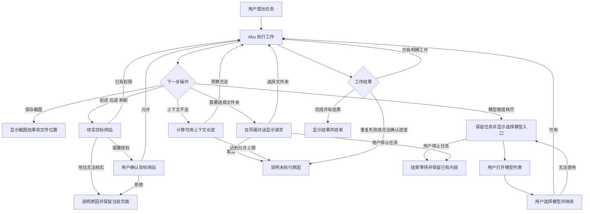

# PR #807 修订任务书

## 1. 用户故事

本任务承接已确认的浏览器与 Goal 产品设计，保留贡献者的提交记录。修订分支基于最新 `dev` 与 PR #807；全部验证通过后提交修订 PR，合并由用户决定。

| 编号 | 优先级 | 用户故事 | 验收场景 |
|---|---|---|---|
| U01 | P1 | 用户让 Abu 保存网页截图，希望文件保存在指定位置，并遵守已有文件权限。 | Given 用户指定保存位置，When Abu 保存截图，Then 授权对象与实际文件一致；未授权位置需要现有权限确认，默认任务目录无需确认。 |
| U02 | P1 | 用户允许 Abu 浏览指定网站，希望前进、后退和刷新继续遵守网站权限。 | Given 当前页面与历史页面属于不同网站，When Abu 后退，Then 按历史目标地址判断权限；地址无法核实时保留当前页面并说明原因。 |
| U03 | P1 | 用户的模型额度耗尽，希望保留任务进度，选择可用模型后继续。 | Given 模型返回额度错误，When 用户打开模型列表并选择模型，Then 系统使用所选模型的凭证、地址和能力继续同一任务，无需再次确认。 |
| U04 | P1 | 用户同时运行多个任务，希望每个问题都可以回答，停止一个任务不会取消其他任务的问题。 | Given 多个任务同时等待选择文件夹或回答问题，When 用户处理其中一个请求或停止其中一个任务，Then 其他请求保持有效，已取消请求的迟到回答不产生授权。 |
| U05 | P2 | 用户运行本地模型，希望上下文不足时系统能够在允许范围内调整并继续。 | Given 当前 Ollama 上下文容纳不了固定内容，When 系统计算可用的新长度，Then 同时计算该长度对应的输出预留和输入预算；无可用长度时明确结束本次恢复。 |
| U06 | P2 | 用户收到任务结果，希望系统正确识别结束，遇到无法继续的步骤时说明原因。 | Given 模型提供完整结果或工具连续重复失败，When 系统判断是否继续，Then 完整结果正常结束；继续执行需要可核实的未完成工作，跳过需要明确事项及原因。 |
| U07 | P2 | 用户运行较长任务，希望压缩对话后仍能找到文件、网页和任务状态。 | Given 重要路径或地址出现在工具参数、结果和上下文记录中，When 对话被压缩，Then 保留有限数量的重要引用，不保存图片数据或大量重复文本。 |

## 2. 业务流程

截图指定位置沿用现有文件授权流程。空结果、权限拒绝、文件名占用、目标目录变化、页面关闭、模型删除、凭证失效、用户停止均返回明确结果。相同文件名选择可用名称；达到名称上限时报告错误，现有文件保持完整。

## 3. 概念对照表

| 用户心里的说法 | 软件内部的叫法 | 界面呈现 |
|---|---|---|
| 保存截图 | screenshot / screenshot_full_page | 保存截图、文件位置 |
| 允许访问这个网站 | origin permission / navigation target | 网站地址、允许、取消 |
| 选择模型并继续 | model recovery / ModelBinding | 选择模型并继续 |
| 模型暂时无法使用 | quota / credentials / provider error | 模型暂时无法使用及具体原因 |
| 选择工作文件夹 | workspace approval | 选择工作文件夹 |
| 等待我的回答 | pending approval | 保持现有问题卡片 |
| 停止任务 | abort / session cancellation | 停止 |
| 任务完成 | verified completion | 已有结果展示 |
| 无法继续及原因 | progress guard / recovery exhaustion | 无法继续及具体原因 |

凭证、RPC、模型能力、文件会话、历史条目标识和预算计算留在内部实现中。

## 4. 功能与流程对应

| 功能 | 对应流程 | 用户操作 |
|---|---|---|
| 截图目标准备、文件授权与执行核实 | 保存截图 | 默认目录零次额外确认；指定位置复用现有授权 |
| 导航目标探测与执行前核实 | 核实目标网站 | 已授权网站零次额外确认 |
| 等待模型选择并恢复任务 | 选择模型并继续 | 打开列表一次、选择模型一次 |
| 请求按所属任务保留与取消 | 选择文件夹、等待回答、停止任务 | 每项决定回答一次，无自动超时 |
| Ollama 完整预算计算 | 计算可用上下文长度 | 无新增设置或确认 |
| 结束与进度判断 | 工作结果 | 完成时无新增确认 |
| 压缩后的引用保留 | 长任务继续执行 | 无新增操作 |

Goal 事项管理、进度面板和报告页面由已确认的完整产品设计规定，另行实施。

## 5. 技术方案

### 浏览器文件保存

保存流程使用现有文件操作授权与 native helper 身份检查。准备阶段确定最终目标及不存在状态，授权阶段核实该目标，执行阶段使用相同文件引用写入；目录替换、符号链接跳转、文件并发出现和任务结束均阻止写入。默认目录由可信 owner 推导并限制在任务目录内。截图目标记录只由执行端创建，绑定 owner、页面和动作，单次使用并随任务释放。

企业文件策略在展示权限请求前检查。截图捕获和写入分别核实任务是否有效；停止任务、撤销目录授权、结束授权范围立即释放文件引用。撤销通知同时携带授权目录的原始路径和解析路径，覆盖符号链接授权。

涉及 `electron/browserHost.cjs`、现有 native helper 文件接口、`src/core/tools/registry.ts`、`browserScreenshotSave.ts`、`pathSafety.ts`、`src/core/mcp/client.ts` 和 `abu-browser-bridge/src/tools.ts`。

### 浏览器历史导航

Electron 使用 `navigationHistory` 获取目标条目；Chrome 在现有权限内通过 Navigation API 获取可核实的历史条目。授权前取得来源及目标标识，执行前重新核实。目标变化或不可读取时返回结构化错误，用户可以通过明确链接继续任务。网站地址的标准化规则在授权与执行时保持一致。

涉及 browser host、bridge、Chrome 扩展命令实现、浏览器权限判断及导航回归测试。

### 模型选择与任务恢复

恢复由 shell 持有请求，用户在既有 `ModelSelector` 中选择模型。shell 重新读取选择、解析凭证和模型档案，创建新的可信模型绑定，再交给当前运行。主循环、子循环和直接委派均使用同一绑定版本；资源权限继续继承原任务。

等待期间不自动超时。停止任务、删除对话和运行进程退出会结束等待。所有异步结果返回后核实运行身份；已结束任务的选择结果无效。切换后刷新 adapter、视觉能力、Computer Use 能力、工具清单、模型名称和上下文预算，清除旧模型专用的恢复参数。

批量子任务的执行计时排除等待模型选择的时间，选择后沿用剩余执行时间。恢复覆盖普通请求与压缩请求；响应中断时保存已有文本，关闭尚未执行的工具进度，保留已完成的工具结果。

涉及 `agentLoopRunner.ts`、`subagentRunner.ts`、sidecar run context 与 reverse RPC、`agentLoop.ts`、`subagentLoop.ts`、模型恢复状态、`ChatView` 和既有 `ModelSelector`。

### 并发请求

命令、文件授权和 workspace 请求分别在各自对话内按顺序显示；回答仅处理对应请求。每个请求使用 host 生成的独立编号，provider 的工具编号可以重复。取消依据可信运行身份和所属对话执行，保留其他任务的请求。请求保留到用户回答或任务结束。文件夹选择返回时更新请求所属对话；只有该对话仍为当前对话时更新全局目录。

涉及 `ports/approvalBridge.ts`、`permissionBridge.ts`、shell 的取消处理、sidecar 通知、对话删除处理及 `ChatView`。

### 上下文与执行进度

Ollama 候选长度必须通过真实 `resolveRequestBudget` 重新计算输出预留、安全余量和输入预算，遵守用户指定长度与允许上限。恢复次数受现有机制限制。

自动继续依据明确的未完成工作和可恢复的空响应；有效完成回复正常结束。重复失败记录具体原因；缺少可验证事项时结束本次运行并保留工作。压缩保留来源包括消息正文、工具参数、工具结果和 `toolCallsForContext`，采用已知字段与总量限制。

## 6. 验证与交付条件

1. 文件验证：默认保存、指定位置授权与拒绝、相对路径、符号链接、目录替换、名称穷尽、并发创建和停止后的迟到结果；验证真实文件内容及原文件完整性。
2. 导航验证：允许网站之间导航、拒绝网站后退、来源变化、目标变化、历史不可读取、刷新、页面关闭；Electron 中运行 `browser-unattended.spec.ts` 的真实路径。
3. 模型验证：两个不同服务地址和凭证、视觉能力变化、工具清单变化、主循环、子循环、直接委派、停止与选择并发、关闭选择器、候选模型失效；选择后没有第三次确认。
4. 请求验证：同一对话多个请求、不同对话并发、停止其中一个任务、删除对话、文件选择器迟到返回、超过原等待时限仍可回答。
5. 预算验证：使用真实预算函数覆盖已复现的 Ollama 参数组合、用户指定长度、允许上限和无可行长度。
6. 进度验证：正常完成不追加请求，空响应有限恢复，重复失败保留原因，压缩后仍保留工具中的重要引用。
7. 更新官方测试清单；运行 `npm run verify`、`npm run electron:dev:check`、受影响 Electron 流程及所需完整 E2E。测试依赖与检查串行执行。
8. 文件权限、导航权限和可信模型绑定由独立审查者复审。所有结论以当前代码与运行结果为准。

交付修订代码、验证记录和保留原贡献历史的修订 PR。原 PR #807 与修订 PR 的合并等待用户决定。
